<!-- if you are reading the source of a readme, you are my people -->

<div align="center">



</div>

```
╔══════════════════════════════════════════════════════════════════╗
║                                                                  ║
║ T R U S H I   B E T H U                                          ║
║ systems · compilers · kernels · things nobody asked for          ║
║                                                                  ║
╠══════════════════════════════════════════════════════════════════╣
║ LANGUAGES....... C · C++ · Rust · x86-64 asm                     ║
║ OS WRITTEN...... 1, from scratch, it boots                       ║
║ COMPILERS....... 1, it talks back                                ║
║ LEETCODE........ 2071                                            ║
║ AUDIO FILES..... 0                                               ║
║ DEPENDENCIES.... 0 (tinybot, on principle)                       ║
║ TESTS PASSING... 93                                              ║
║ BUGS............ [REDACTED]                                      ║
║ SLEEP........... ▒▒▒▒▒▒▒ not found                                 
║ SANITY.......... segfault (core dumped)
║
╚════════════════════════════════════════════░░░▒▒▒▓▓▓▓
```

everything above this line is accurate and neatly aligned.
everything below is also accurate. it is wearing a ski mask.


<div align="center">

<a href="https://github.com/Trushi28/Aphelion"></a>
<a href="https://github.com/Trushi28/QISC"></a>
<a href="https://tinybot-self.vercel.app/"></a>
<a href="https://github.com/Trushi28?tab=repositories"></a>
<a href="https://github.com/Trushi28?tab=repositories"></a>

</div>

<sub>aphelion: the filesystem is mine too. copy-on-write, snapshots, checksums, and a crash-fuzzer I don't fully trust. &nbsp;·&nbsp; qisc has a panic mode that says "continuing anyway because I'm either brave or stupid." the personality system was not on the roadmap. it's the best part. &nbsp;·&nbsp; tinybot: I wrote 93 tests for a chatbot that can be offended. normal behavior.</sub>


```
1. if it has a dependency, I'll write it myself out of spite
2. if it's POSIX, I'm doing it differently
3. if it looks too clean, hide a joke in the assembly
4. never ship an audio file
5. if it passes on the first run, be suspicious
6. every rule above is negotiable except 4
```




<sub>every issue above is working as intended. the maintainer is also the issue.</sub>







<div align="center">

<a href="https://portfolio-os-nu.vercel.app/"></a>
<a href="https://www.linkedin.com/in/trushi-bethu-879984335/"></a>
<a href="https://mail.google.com/mail/?view=cm&amp;fs=1&amp;to=trushibethu@gmail.com&amp;su=complaint%20%23007"></a>

</div>

<sub>all complaints are read. replies take a few commits.<br>if the button fights you: trushibethu@gmail.com</sub>


